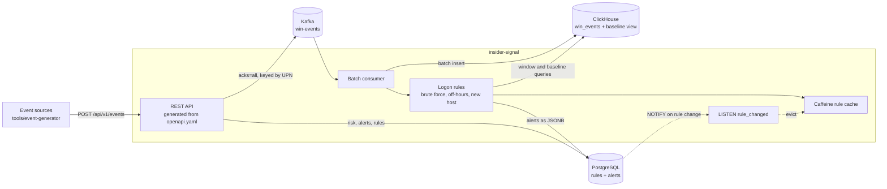

# insider-signal

**A small UEBA (user behaviour analytics) service.** It ingests Windows security events and flags risky user behaviour: a brute-force attack that succeeded, or a logon that is unusual for this user.

    

This is a focused prototype I built to explore the insider-threat problem space, not a production system. It is API-only: there is no UI. The limitations are [listed below](#known-limitations).

## What it does

- **Brute force, then success:** 5 or more failed logons (4625) for an account within 5 minutes, then a success (4624), raises a `HIGH` alert with the event IDs as evidence.
- **Unusual logon:** a ClickHouse materialised view keeps each user's normal pattern. A logon at an hour they rarely work, or from a host they have not used in 30 days, raises their risk score.
- **Risk score with reasons:** `GET /api/v1/users/{upn}/risk` says how risky a user looks and why.
- **Live rule changes:** change a threshold through the API, and the next event is scored under the new rule on every instance, without a restart.

## Architecture



## How it maps to the role

| The role asks for | In this repo |
|---|---|
| Java 21, Spring Boot | Records, sealed interfaces, virtual threads, Spring Boot 3.5 |
| Stream/event-driven at volume | Kafka batch consumer into ClickHouse; `EventStream` interface ([ADR 0001](docs/adr/0001-kafka-for-the-event-stream.md)) |
| Contract-first REST | [`api/openapi.yaml`](api/openapi.yaml) comes first; controllers implement generated interfaces |
| Docker, CI/CD | Docker Compose; GitHub Actions build, Testcontainers tests and image push |
| Strong SQL | Hand-written ClickHouse aggregation and Postgres JSONB queries in [`store`](src/main/java/com/insidersignal/store) |
| ClickHouse / OLAP | `ReplacingMergeTree` events, `AggregatingMergeTree` baseline, materialised view ([schema](src/main/resources/db/clickhouse/schema.sql)) |
| PostgreSQL JSONB, cache invalidation | Rules and alerts in JSONB; Caffeine evicted across instances by `LISTEN/NOTIFY` ([ADR 0003](docs/adr/0003-rule-cache-invalidation.md)) |
| Windows event logs / AD | Event IDs 4624, 4625, 4728, 4732; UPNs |

Not built yet, and designed for discussion: a Redis Streams adapter, a C# parity test, and Azure deployment (see [`SPEC.md`](SPEC.md)).

## Run it

Needs Docker and Java 21.

```bash
cp .env.example .env
```

```bash
docker compose up -d --build --wait
```

The API is on http://localhost:8090, bound to localhost only.

## 5-minute demo

**1. Seed 30 days of history, then normal traffic.** No alerts should appear.

```bash
java tools/event-generator/EventGenerator.java history
```

```bash
java tools/event-generator/EventGenerator.java traffic
```

```bash
curl -s localhost:8090/api/v1/alerts | jq length
```

**2. Run a brute-force attack and see the alert.**

```bash
java tools/event-generator/EventGenerator.java attack dave@contoso.example
```

```bash
curl -s "localhost:8090/api/v1/alerts?upn=dave@contoso.example" | jq
```

```json
{
  "id": "brute-force:attack-1793638809773-0",
  "ruleId": "brute-force",
  "upn": "dave@contoso.example",
  "severity": "HIGH",
  "score": 60,
  "reason": "8 failed logons within 5 minutes, then a successful logon on wks-dave-01",
  "evidenceEventIds": ["attack-1793638809773-8", "…", "attack-1793638809773-0"]
}
```

**3. See a logon from a new host raise a risk score.**

```bash
java tools/event-generator/EventGenerator.java probe carol@contoso.example srv-finance-09
```

```bash
curl -s localhost:8090/api/v1/users/carol@contoso.example/risk | jq
```

**4. Look at a user's baseline in ClickHouse.** Alice has only 3 logons in the current hour and the next.

```bash
docker compose exec clickhouse clickhouse-client --user insider --password insider -q "SELECT hour, host, uniqExactMerge(logons) AS logons FROM user_logon_baseline WHERE upn = 'alice@contoso.example' GROUP BY hour, host ORDER BY hour FORMAT PrettyCompact"
```

**5. Change a rule live.** Alice's logon is fine under the default threshold of 1:

```bash
java tools/event-generator/EventGenerator.java probe alice@contoso.example wks-alice-01
```

```bash
curl -s localhost:8090/api/v1/users/alice@contoso.example/risk | jq .score
```

Raise the threshold to 5, and check the eviction in the log:

```bash
curl -s -X PUT localhost:8090/api/v1/rules/off-hours -H 'Content-Type: application/json' -d '{"config":{"minBaselineLogons":20,"minLogonsInHour":5,"score":30}}' | jq
```

```bash
docker compose logs app | grep "Rule changed"
```

The next identical logon now raises her score, with no restart:

```bash
java tools/event-generator/EventGenerator.java probe alice@contoso.example wks-alice-01
```

```bash
curl -s localhost:8090/api/v1/users/alice@contoso.example/risk | jq
```

Clean up with:

```bash
docker compose down -v
```

## Design trade-offs

- **Why Kafka rather than Redis Streams at volume?** Retention and replay absorb long outages without memory pressure. Redis would be lighter to run, so `EventStream` keeps the option open. See [ADR 0001](docs/adr/0001-kafka-for-the-event-stream.md).
- **Why ClickHouse for events and Postgres for state?** Events are append-only and aggregated; rules and alerts need updates, uniqueness and transactions. See [ADR 0002](docs/adr/0002-clickhouse-for-events-postgres-for-state.md).
- **How are inserts idempotent?** Kafka delivers at least once, so every step tolerates repeats: `ReplacingMergeTree` with `FINAL` for events, `uniqExactState(event_id)` for the baseline because the view sees duplicates, and a deterministic alert key with `ON CONFLICT DO NOTHING`.
- **How are late or out-of-order events handled?** Everything uses event time, each batch is stored before evaluation, and events over 24 hours old build the baseline without raising alerts. There is a known gap across batches. See [ADR 0004](docs/adr/0004-late-and-out-of-order-events.md).
- **Why `LISTEN/NOTIFY` rather than a compacted Kafka topic?** `NOTIFY` is transactional with the update, so there is no dual write. See [ADR 0003](docs/adr/0003-rule-cache-invalidation.md).
- **What happens when ClickHouse is down?** The API keeps accepting events into Kafka; the consumer retries with backoff and catches up, with no dead-letter topic.

## Known limitations

- **No authentication.** Anyone who can reach the API can change rules, which is why Compose binds it to localhost. Real use needs OAuth2 and role separation.
- **A genuine logon can mask an attack.** A success resets the failure count (so one attack raises one alert), so a real logon between the last failures and the attacker's success hides it. Tracking by source would fix this.
- **Late 4625s across batches** are missed if the 4624 was processed first ([ADR 0004](docs/adr/0004-late-and-out-of-order-events.md)).
- **Hours are UTC**, not the user's local time, so travel and daylight saving shift the pattern. Future-dated events are not rejected.
- **Per-logon queries.** Each logon runs up to three ClickHouse queries. Batching them per poll is the next step before real volume.
- **Group changes** (4728, 4732) are stored but no rule uses them yet.
- A stuck batch retries forever, so a deterministic bug would stall its partition. That is visible in logs and consumer lag, and chosen over silently dropping security events.

## Development

This project uses plan-first, strict TDD. See [`CLAUDE.md`](CLAUDE.md).

```bash
mvn com.spotify.fmt:fmt-maven-plugin:format
```

```bash
mvn verify
```

`mvn verify` runs the format check, unit tests with in-memory fakes, and integration tests against real Postgres, ClickHouse and Kafka (Testcontainers, needs Docker).

| Path | What |
|---|---|
| `api/openapi.yaml` | The contract |
| `src/main/java/.../api` | Controllers and error handling (HTTP only) |
| `src/main/java/.../ingest` | Event stream: Kafka producer and consumer |
| `src/main/java/.../detect` | Rules, baseline logic, risk scoring (no framework dependencies) |
| `src/main/java/.../store` | ClickHouse and Postgres repositories, `LISTEN/NOTIFY` |
| `src/main/resources/db/` | Flyway migrations and ClickHouse DDL |
| `tools/event-generator/` | Replays realistic traffic |
| `docs/adr/`, `docs/features/` | Decisions and plans |
